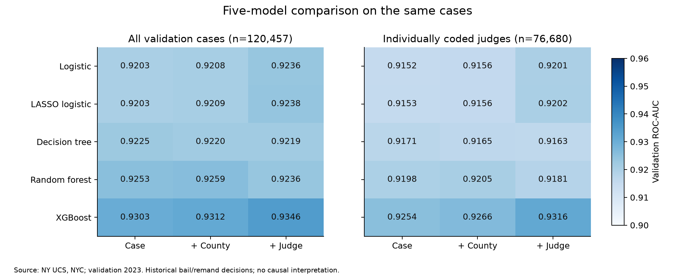
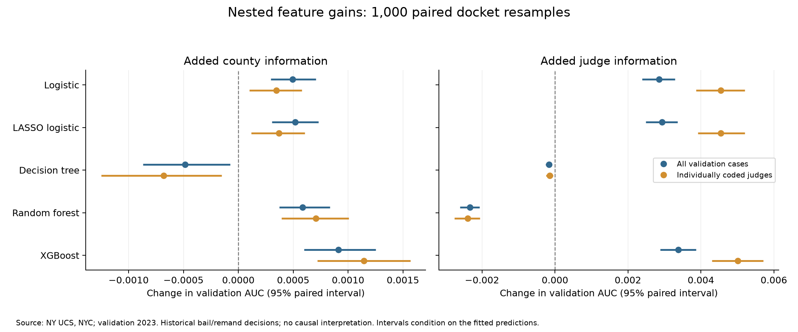
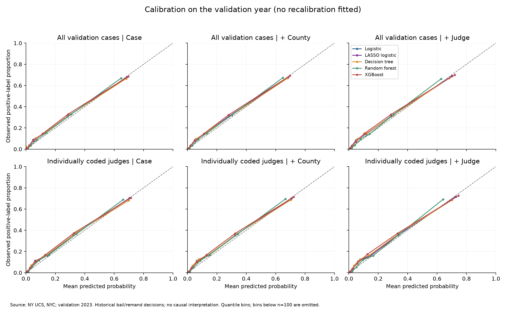

# BD-06 validation comparison and model recommendation

Analysis date: 2026-11-15. Validation year: 2023.

**Status:** Shuyi's comparison is complete. The validation-AUC candidate is **xgb / CASE_COURT_JUDGE**, AUC **0.934624**, AP **0.703310**, Brier **0.063059**. This is a recommendation for the group decision, not a claim that the model, thresholds or final-test workflow have already been frozen.

## Inputs and boundaries

- Main source commit: `81c4231df95a91e0c8440fd53171f4e98e2eb96c`. Ensemble predictions: PR #7 commit `51dd03b39aaf6fd5f76aa3d505b809f69f398232 (code); predictions re-generated locally by notebook 06`, final training-only early-stopping [Release](https://github.com/POL408-Team5/ny-pretrial-detention/releases/tag/e02-pr7-early-stopping). The PR is a separate review/merge step.
- The ensemble file and companion manifest match the published Release SHA-256 digests. All twelve ensemble metric rows were independently recomputed against the manifest; main baseline validation metrics were checked against the committed main report.
- Training years: [2021, 2022]; validation: 2023. Every supplied model-feature pair has the same case IDs, years and labels. Test/apparent-training rows, nondevelopment years, duplicates, missing cases and invalid probabilities are rejected before comparison.
- Five models x three main feature sets; the two-field charge rule appears once under CASE. Gender supplements are audited for alignment but excluded from all primary comparisons. Race, ethnicity and gender are not added to main predictors.
- No model was retrained, recalibrated or tuned in BD-06. No fairness threshold was selected. No final-test raw file or test prediction was read or generated, and `run_test=True` remains disabled.

## Full validation comparison

| model | feature_set | roc_auc | auc_ci_low | auc_ci_high | avg_precision | brier | mean_pred | calibration_gap | n |
|---|---|---|---|---|---|---|---|---|---|
| rule | CASE | 0.846492 | 0.843344 | 0.849698 | 0.478021 | 0.080927 | 0.127613 | -0.000566 | 120457 |
| logit | CASE | 0.920289 | 0.918308 | 0.922278 | 0.662465 | 0.067290 | 0.119961 | -0.008217 | 120457 |
| logit | CASE_COURT | 0.920785 | 0.918848 | 0.922722 | 0.665713 | 0.067026 | 0.119655 | -0.008523 | 120457 |
| logit | CASE_COURT_JUDGE | 0.923637 | 0.921759 | 0.925506 | 0.677013 | 0.065788 | 0.120279 | -0.007899 | 120457 |
| lasso | CASE | 0.920337 | 0.918348 | 0.922327 | 0.662595 | 0.067270 | 0.119984 | -0.008194 | 120457 |
| lasso | CASE_COURT | 0.920855 | 0.918928 | 0.922802 | 0.665698 | 0.067029 | 0.119641 | -0.008538 | 120457 |
| lasso | CASE_COURT_JUDGE | 0.923789 | 0.921891 | 0.925647 | 0.677448 | 0.065698 | 0.121306 | -0.006873 | 120457 |
| tree | CASE | 0.922505 | 0.920519 | 0.924301 | 0.655781 | 0.067615 | 0.120376 | -0.007802 | 120457 |
| tree | CASE_COURT | 0.922019 | 0.920010 | 0.923799 | 0.656373 | 0.067652 | 0.119983 | -0.008195 | 120457 |
| tree | CASE_COURT_JUDGE | 0.921855 | 0.919843 | 0.923679 | 0.656324 | 0.067652 | 0.119960 | -0.008218 | 120457 |
| rf | CASE | 0.925338 | 0.923491 | 0.927052 | 0.668503 | 0.066736 | 0.121773 | -0.006405 | 120457 |
| rf | CASE_COURT | 0.925922 | 0.924075 | 0.927670 | 0.673366 | 0.066312 | 0.121371 | -0.006807 | 120457 |
| rf | CASE_COURT_JUDGE | 0.923587 | 0.921719 | 0.925401 | 0.667944 | 0.067245 | 0.122755 | -0.005423 | 120457 |
| xgb | CASE | 0.930331 | 0.928510 | 0.932034 | 0.683544 | 0.065037 | 0.118611 | -0.009568 | 120457 |
| xgb | CASE_COURT | 0.931244 | 0.929472 | 0.932976 | 0.690430 | 0.064394 | 0.117839 | -0.010340 | 120457 |
| xgb | CASE_COURT_JUDGE | 0.934624 | 0.932905 | 0.936279 | 0.703310 | 0.063059 | 0.119165 | -0.009014 | 120457 |

AUC is ranking, not accuracy. AP is interpreted alongside positive-label prevalence; lower Brier indicates better probability accuracy. Calibration gap is mean prediction minus observed label prevalence. The rule's CASE label does not mean it uses all CASE inputs. The SVM screening decision is documented in the role handoff; no extra family is trained here.

## Nested information gains: paired intervals

| cohort | model | comparison | delta_roc_auc | ci_low | ci_high | delta_avg_precision | delta_brier | n |
|---|---|---|---|---|---|---|---|---|
| all_valid | logit | CASE_COURT minus CASE | 0.000496 | 0.000297 | 0.000706 | 0.003248 | -0.000265 | 120457 |
| all_valid | logit | CASE_COURT_JUDGE minus CASE_COURT | 0.002852 | 0.002390 | 0.003294 | 0.011300 | -0.001238 | 120457 |
| all_valid | lasso | CASE_COURT minus CASE | 0.000518 | 0.000307 | 0.000731 | 0.003103 | -0.000241 | 120457 |
| all_valid | lasso | CASE_COURT_JUDGE minus CASE_COURT | 0.002934 | 0.002491 | 0.003358 | 0.011750 | -0.001331 | 120457 |
| all_valid | tree | CASE_COURT minus CASE | -0.000486 | -0.000869 | -0.000073 | 0.000592 | 0.000037 | 120457 |
| all_valid | tree | CASE_COURT_JUDGE minus CASE_COURT | -0.000164 | -0.000255 | -0.000080 | -0.000049 | -0.000000 | 120457 |
| all_valid | rf | CASE_COURT minus CASE | 0.000584 | 0.000374 | 0.000834 | 0.004863 | -0.000424 | 120457 |
| all_valid | rf | CASE_COURT_JUDGE minus CASE_COURT | -0.002335 | -0.002600 | -0.002063 | -0.005422 | 0.000933 | 120457 |
| all_valid | xgb | CASE_COURT minus CASE | 0.000913 | 0.000599 | 0.001252 | 0.006885 | -0.000643 | 120457 |
| all_valid | xgb | CASE_COURT_JUDGE minus CASE_COURT | 0.003380 | 0.002885 | 0.003867 | 0.012880 | -0.001336 | 120457 |
| coded_judges | logit | CASE_COURT minus CASE | 0.000347 | 0.000100 | 0.000578 | 0.002866 | -0.000304 | 76680 |
| coded_judges | logit | CASE_COURT_JUDGE minus CASE_COURT | 0.004549 | 0.003862 | 0.005199 | 0.016774 | -0.002069 | 76680 |
| coded_judges | lasso | CASE_COURT minus CASE | 0.000370 | 0.000119 | 0.000604 | 0.002679 | -0.000277 | 76680 |
| coded_judges | lasso | CASE_COURT_JUDGE minus CASE_COURT | 0.004549 | 0.003922 | 0.005199 | 0.016898 | -0.002098 | 76680 |
| coded_judges | tree | CASE_COURT minus CASE | -0.000681 | -0.001249 | -0.000151 | 0.000304 | 0.000080 | 76680 |
| coded_judges | tree | CASE_COURT_JUDGE minus CASE_COURT | -0.000148 | -0.000246 | -0.000055 | -0.000046 | -0.000000 | 76680 |
| coded_judges | rf | CASE_COURT minus CASE | 0.000707 | 0.000395 | 0.001008 | 0.004549 | -0.000484 | 76680 |
| coded_judges | rf | CASE_COURT_JUDGE minus CASE_COURT | -0.002394 | -0.002757 | -0.002059 | -0.004000 | 0.000963 | 76680 |
| coded_judges | xgb | CASE_COURT minus CASE | 0.001143 | 0.000720 | 0.001567 | 0.006851 | -0.000712 | 76680 |
| coded_judges | xgb | CASE_COURT_JUDGE minus CASE_COURT | 0.005006 | 0.004301 | 0.005713 | 0.017955 | -0.002080 | 76680 |

Differences are larger minus smaller feature set on the same cases. Positive AUC/AP and negative Brier differences favor the larger set. Include negative results: the direction of a judge gain is not assumed to be positive for every algorithm. An AUC difference is not the proportion of decisions caused or explained by a judge.

## Individually coded judge subset

The all-case cohort contains **120,457** cases. The diagnostic subset contains **76,680** cases (**63.66%** of validation), selected only by training-year `judge_id` starting with J. `other`, `unseen` and missing IDs are excluded; `judge_id_final` is never used for this validation subset. Every model is rescored on this same subset, not just the judge model.

| model | feature_set | roc_auc | auc_ci_low | auc_ci_high | avg_precision | brier | n |
|---|---|---|---|---|---|---|---|
| rule | CASE | 0.839055 | 0.834858 | 0.842991 | 0.482688 | 0.088420 | 76680 |
| logit | CASE | 0.915232 | 0.912621 | 0.917698 | 0.669162 | 0.073050 | 76680 |
| logit | CASE_COURT | 0.915579 | 0.912938 | 0.918067 | 0.672028 | 0.072745 | 76680 |
| logit | CASE_COURT_JUDGE | 0.920129 | 0.917495 | 0.922584 | 0.688802 | 0.070676 | 76680 |
| lasso | CASE | 0.915277 | 0.912657 | 0.917729 | 0.669296 | 0.073027 | 76680 |
| lasso | CASE_COURT | 0.915647 | 0.912982 | 0.918119 | 0.671975 | 0.072750 | 76680 |
| lasso | CASE_COURT_JUDGE | 0.920196 | 0.917570 | 0.922639 | 0.688873 | 0.070652 | 76680 |
| tree | CASE | 0.917136 | 0.914676 | 0.919374 | 0.661436 | 0.073626 | 76680 |
| tree | CASE_COURT | 0.916455 | 0.913972 | 0.918720 | 0.661740 | 0.073705 | 76680 |
| tree | CASE_COURT_JUDGE | 0.916307 | 0.913806 | 0.918597 | 0.661694 | 0.073705 | 76680 |
| rf | CASE | 0.919776 | 0.917334 | 0.922073 | 0.673559 | 0.072670 | 76680 |
| rf | CASE_COURT | 0.920482 | 0.918048 | 0.922797 | 0.678108 | 0.072186 | 76680 |
| rf | CASE_COURT_JUDGE | 0.918088 | 0.915607 | 0.920463 | 0.674109 | 0.073149 | 76680 |
| xgb | CASE | 0.925416 | 0.922983 | 0.927666 | 0.688768 | 0.070736 | 76680 |
| xgb | CASE_COURT | 0.926560 | 0.924216 | 0.928819 | 0.695620 | 0.070024 | 76680 |
| xgb | CASE_COURT_JUDGE | 0.931566 | 0.929314 | 0.933738 | 0.713575 | 0.067945 | 76680 |

This subset answers a coverage diagnostic. It is not a replacement for the all-case result, a randomized judge comparison or proof of the effect of unfamiliar judges. Its case mix may differ from the whole validation sample.

## Probability calibration

Quantile-bin mean predictions are compared with observed positive-label proportions, separately in each cohort. Ties are not artificially split; bins below `config.MIN_GROUP_N` are omitted. No recalibration was fitted. Mean gaps and Brier scores complement the plots; these are overall/coded-judge diagnostics, not the protected-group fairness analysis assigned to C.

## Candidate comparisons against logistic baselines

| cohort | model | reference_model | feature_set | delta_roc_auc | ci_low | ci_high | delta_avg_precision | delta_brier |
|---|---|---|---|---|---|---|---|---|
| all_valid | xgb | logit | CASE | 0.010042 | 0.009210 | 0.010772 | 0.021079 | -0.002253 |
| all_valid | xgb | lasso | CASE | 0.009994 | 0.009160 | 0.010733 | 0.020949 | -0.002233 |
| all_valid | xgb | logit | CASE_COURT | 0.010459 | 0.009636 | 0.011283 | 0.024717 | -0.002631 |
| all_valid | xgb | lasso | CASE_COURT | 0.010389 | 0.009572 | 0.011218 | 0.024732 | -0.002634 |
| all_valid | xgb | logit | CASE_COURT_JUDGE | 0.010987 | 0.010118 | 0.011827 | 0.026297 | -0.002729 |
| all_valid | xgb | lasso | CASE_COURT_JUDGE | 0.010835 | 0.009963 | 0.011679 | 0.025862 | -0.002639 |
| coded_judges | xgb | logit | CASE | 0.010184 | 0.009161 | 0.011234 | 0.019606 | -0.002314 |
| coded_judges | xgb | lasso | CASE | 0.010140 | 0.009115 | 0.011194 | 0.019473 | -0.002291 |
| coded_judges | xgb | logit | CASE_COURT | 0.010980 | 0.009876 | 0.012099 | 0.023592 | -0.002721 |
| coded_judges | xgb | lasso | CASE_COURT | 0.010913 | 0.009814 | 0.012020 | 0.023645 | -0.002726 |
| coded_judges | xgb | logit | CASE_COURT_JUDGE | 0.011437 | 0.010286 | 0.012736 | 0.024773 | -0.002732 |
| coded_judges | xgb | lasso | CASE_COURT_JUDGE | 0.011370 | 0.010217 | 0.012698 | 0.024702 | -0.002707 |

These candidate diagnostics are conditional on the fitted models and validation selection. They are not multiple-comparison- or model-selection-adjusted significance claims.

## Uncertainty method and limits

- Ordinary docket-level percentile bootstrap, 1,000 draws, seed 408. Each draw resamples the same docket indices for every prediction column in a cohort. Exact multiplicity-weighted AUC includes half credit for tied scores and is checked against sklearn and the existing paired-bootstrap helper. No tuning or model refitting occurs inside this bootstrap.
- Marginal AUC and paired difference intervals use the 2.5th/97.5th percentiles. Finite-draw counts are retained. Full/subset cohorts are analyzed separately; their intervals are not an interval for the difference between cohorts.
- These intervals condition on fitted predictions and do not account for model-selection uncertainty, retraining, within-judge correlation or unlinked repeated defendants. They are not judge-cluster intervals or causal estimates. Small deltas should be assessed for magnitude as well as their interval.
- Training OOF uses training-selected parameters and is a diagnostic rather than nested-CV performance. Final model choice uses validation; generalization to the next year remains untested until the separately authorized freeze and BD-07.
- Prior/pending-record reference dates remain undocumented (data/README.md D14). Court/judge assignment is not randomized. Predicting historical bail/remand decisions does not establish appropriate decisions, actual detention or future offending.

## Group decision and handoff

1. Review the candidate's AUC/AP/Brier and calibration, including negative judge gains in other model families and the individually coded-judge diagnostic.
2. C supplies the validation-year policy thresholds and protected-group error audit; tied probabilities need an explicit threshold convention. This report does not replace C's analysis.
3. Confirm and record the final family, three feature sets, selected parameters, preprocessing, package versions, threshold(s), and XGBoost stopping/refit policy before using the test year. The current 2000 rounds is a search ceiling, not the saved model's selected tree count.
4. BD-07 must separately implement/test the final refit path on expanded training years, use `get_X(..., final=True)` for the final judge mapping, preserve frozen choices and run the final test once after the 11/16 freeze. Policy-threshold confusion matrices belong to that stage.
5. E owns SHAP/permutation and C owns test fairness/residuals. Test-set explanations must not feed back into model/feature/threshold retuning. A owns final-model sensitivity checks and source/literature limitations. Q3 and extra clustering are not part of BD-06.

Only aggregate tables/figures, the notebook, evaluation code/tests and Shuyi's status/records are review candidates. Case predictions, raw files, bootstrap draws and fitted models are local-only. No teammate source file or data definition was changed.
