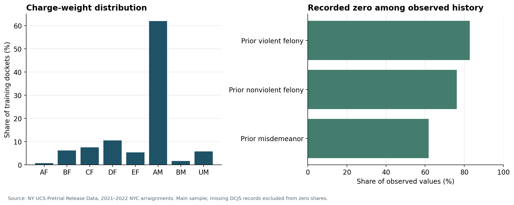
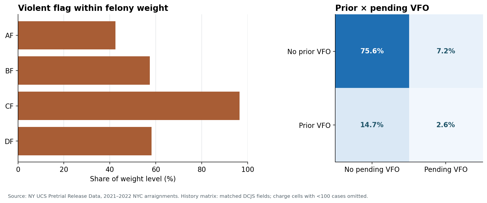
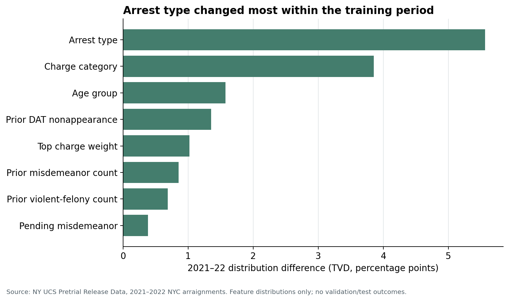
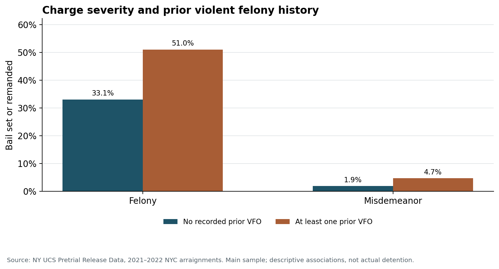
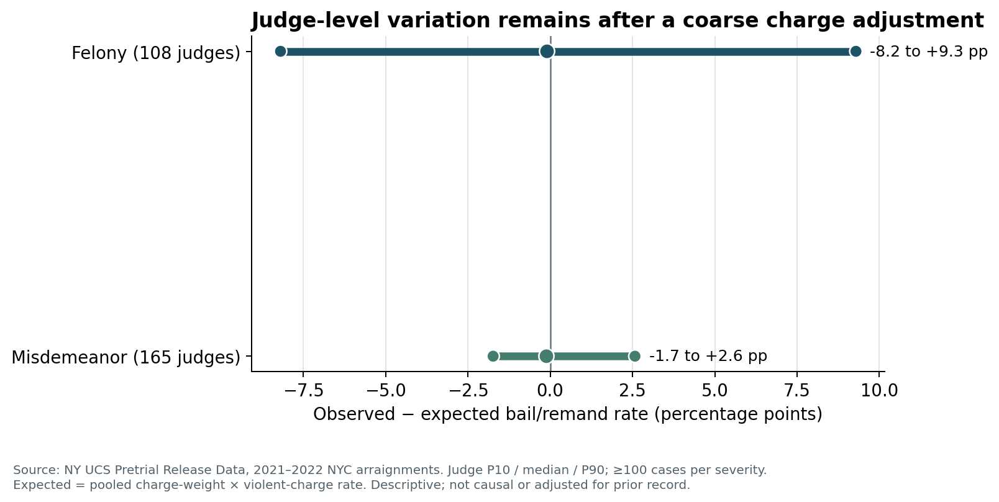
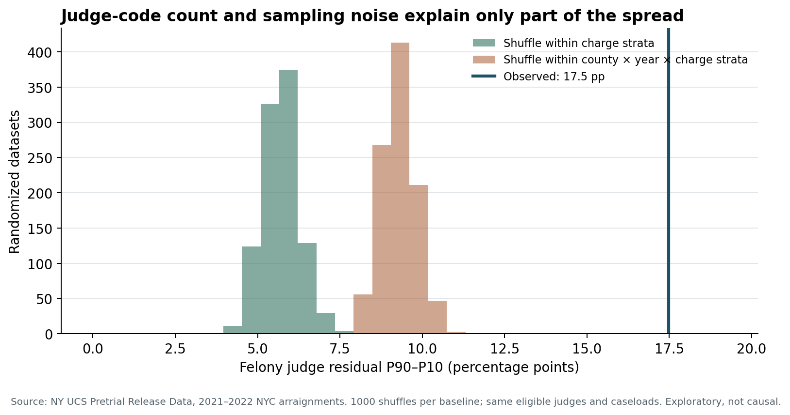

# E-01 Exploratory Data Analysis: NYC Arraignment Decisions

**Review draft — 2026-11-08**

**Source:** New York State Unified Court System, *Pretrial Release Data*, 2021–22 NYC arraignments. See the [data provenance and sample rules](../data/README.md) and the executable [EDA notebook](../notebooks/04_eda.ipynb).

## Executive summary

The training main sample contains **193,196 defendant-dockets**. In **12.93%**, the arraignment decision was to set bail or remand. This is a decision measure, **not actual detention**. The 18 CASE inputs are concentrated in a few common charge levels and recorded-zero history values. Most fields are complete in the main sample; the large blank share in the attempt indicator is a coded non-attempt, while roughly 0.9% of history fields lack a DCJS match. Arrest type changed more than other CASE inputs between the two training years. The largest descriptive outcome contrasts are associated with charge severity, a violent-felony charge flag, and recorded prior or pending cases.

The most actionable EDA finding is variation across anonymously coded judges. Among 108 judges with at least 100 felony cases, the 10th and 90th percentiles of observed-minus-expected bail/remand rates are **−8.2 and +9.3 percentage points** after a coarse adjustment for charge weight and the violent-felony flag. A training-only permutation diagnostic shows that the number of judge codes and caseload sampling explain part of the spread. The next analysis should test whether adding judge identity improves **2023 validation-year** prediction after case and court features. The descriptive spread does not identify a causal judge effect.

## Scope and reporting rules

- Unit: one de-identified defendant-docket. The same person's separate dockets generally cannot be linked.
- Years: **2021–22 training cases only**. No 2023 validation outcome or 2024 test outcome was used in this report.
- Main sample: five NYC counties; decisions of ROR, nonmonetary release, bail set, or remand; local-court docket and felony youth complaint case types; nominal bail excluded; one eligible docket per linked arrest cycle.
- Outcome: `y_detain = 1` for **bail set or remanded**, `0` for ROR or nonmonetary release.
- Tables show docket counts and within-group outcome rates. Levels with fewer than `config.MIN_GROUP_N` dockets are omitted. A rate is suppressed (`—`) when either outcome count is below that threshold. Missing DCJS history is kept separate from a recorded zero.
- All comparisons below are descriptive. Recorded race and gender are audit variables, not predictors in the three main feature sets.

| Arraignment year | Main-sample dockets | Bail set or remanded |
|---|---:|---:|
| 2021 | 89,189 | 12.91% |
| 2022 | 104,007 | 12.95% |
| **Pooled** | **193,196** | **12.93%** |

## Feature-first audit of X

The full aggregate [feature inventory](e01_feature_inventory.csv), [publishable level counts](e01_feature_levels.csv), [year-specific level counts](e01_feature_year_levels.csv), [joint history table](e01_feature_joint_history.csv), [year-by-year summary](e01_feature_yearly.csv), and [distribution drift table](e01_feature_drift.csv) are generated by notebook 04. Together they cover every input in `config.FEATURES_CASE`. The tables contain no docket-level rows.

### Completeness and distribution shape

| CASE input or family | Training-sample distribution | Missing or coding note |
|---|---|---|
| Top severity | 69.45% misdemeanor, 30.55% felony | No missing values |
| Top charge weight | AM is 61.97% of dockets; eight observed levels | No missing values; full level counts in CSV |
| Violent-felony charge flag | N is 82.65%, Y is 17.35% | No missing values |
| Attempt indicator | 97.48% blank | Blank means **not attempt** under the project feature rule; it is not general data loss |
| Arraignment charge category | 21 levels; Assault is 38.46% | No missing values |
| Hate-crime indicator | N is 99.84% | No missing values; highly concentrated |
| Arrest type | Custody 85.22%, DAT 14.78% | No missing values in the main sample |
| Case type | Docket 98.99%; remainder felony youth complaint | No missing values |
| Prior violent-felony count | 82.76% recorded zero among observed; median 0, P90 1 | 0.89% lack a DCJS match; source count capped at 2 |
| Prior nonviolent-felony count | 76.15% recorded zero; median 0, P90 2 | 0.89% missing; capped at 4 |
| Prior misdemeanor count | 61.80% recorded zero; median 0, P90 7 | 0.89% missing; capped at 10 |
| Pending violent felony / nonviolent felony / misdemeanor | Recorded-zero shares: 90.30% / 83.83% / 79.74% | Each is a 0/1 field; 0.89% missing DCJS match |
| Supervision | 94.32% recorded zero among observed | 0.89% missing DCJS match |
| `dcjs_missing` flag | 0.89% marked 1 | Explicit indicator; never replace missing history with zero |
| Prior DAT nonappearance indicator | N is 96.12% | No missing values |
| Age at arrest | Median 33, P90 54, P99 67 | 27 dockets missing after the project's age-zero correction |

The count fields have large masses at zero and capped upper values. Their numeric magnitudes should not be interpreted as uncapped lifetime totals. The attempt indicator's blank value has a different meaning from missing DCJS history. These distinctions are preserved in the project's feature interface.



### Relationships among inputs

Charge weight and the violent-felony flag are related but not interchangeable. Among felony charge-weight levels with at least 100 flagged cases, the violent flag appears in **42.48% of AF**, **57.42% of BF**, **96.41% of CF**, and **58.17% of DF** dockets. This helps explain why a single ordered charge-weight score would miss some charge composition. It also matters when interpreting separate feature-importance values later.

Among **191,482** dockets with observed prior and pending VFO fields, the joint distribution is:

| Prior violent felony | Pending violent felony | Dockets | Share of matched dockets |
|---|---|---:|---:|
| No recorded prior | No recorded pending | 144,784 | 75.61% |
| No recorded prior | Pending | 13,691 | 7.15% |
| Prior | No recorded pending | 28,116 | 14.68% |
| Prior | Pending | 4,891 | 2.55% |

The two history fields carry overlapping information but represent different recorded conditions. The available documentation does not establish their reference date.



### Change within the training period

For each CASE input, the notebook compares its **2021 versus 2022 distribution** using total variation distance (TVD: half the sum of absolute differences in level shares). Age uses the project age bins. This is a descriptive feature-drift measure, not a model score.

| Input | TVD, percentage points | Concrete change |
|---|---:|---|
| Arrest type | 5.57 | DAT share fell from **17.77% to 12.21%** |
| Arraignment charge category | 3.85 | Larceny share rose from 7.41% to 9.78%; other categories also shifted |
| Age at arrest (binned) | 1.57 | Median remained 33 years |
| Prior DAT nonappearance indicator | 1.35 | Y share fell from 4.60% to 3.25% |
| Charge weight | 1.02 | Smaller change than arrest type |

By comparison, felony share was **30.44% in 2021 and 30.64% in 2022**, and the violent-charge flag share was **17.47% and 17.25%**. The arrest-type change deserves attention when interpreting models trained across years; the EDA alone does not identify its cause.



## 1. Charges and case characteristics

Charge-related variables carry the strongest visible contrasts in the one-variable summaries. Rates across charge-weight levels are not monotone; each level contains different offenses and case mixes.

| Variable | Level | Dockets | Bail set or remanded |
|---|---|---:|---:|
| Top severity | Felony | 59,016 | 37.08% |
| Top severity | Misdemeanor | 134,180 | 2.31% |
| Violent-felony charge flag | Y | 33,516 | 51.12% |
| Violent-felony charge flag | N | 159,680 | 4.91% |
| Charge weight | AF | 1,483 | 78.42% |
| Charge weight | BF | 12,063 | 46.05% |
| Charge weight | CF | 14,555 | 55.52% |
| Charge weight | DF | 20,432 | 24.78% |
| Charge weight | EF | 10,483 | 19.29% |
| Charge weight | AM | 119,732 | 2.56% |
| Charge weight | BM | 3,211 | — |
| Charge weight | UM | 11,237 | — |

The twelve most frequent `arraign_charge_category` levels are selected by docket count, not by outcome rate:

| Charge category | Dockets | Bail set or remanded | Charge category | Dockets | Bail set or remanded |
|---|---:|---:|---|---:|---:|
| Assault | 74,311 | 6.95% | Larceny | 16,774 | 6.44% |
| Property | 14,715 | 3.39% | Drug | 12,912 | 8.80% |
| Criminal Contempt | 10,883 | 18.09% | Criminal Possession of a Weapon | 9,801 | 52.55% |
| Robbery | 8,510 | 45.04% | Other | 7,995 | 2.96% |
| Burglary | 6,872 | 32.74% | Unlicensed Operation | 6,268 | — |
| DWI | 5,367 | — | Aggravated Harassment | 4,946 | 4.61% |

## 2. Prior record, pending cases, and supervision

The table compares a recorded zero with any recorded positive value. The 1,714 dockets missing the DCJS prior-VFO field are excluded from those two denominators; missing does **not** mean no prior record. The reference date of the prior and pending fields is not documented in the available UCS materials, which limits their use in a stronger interpretation.

| Variable | No recorded count: dockets | Rate | Any recorded count: dockets | Rate |
|---|---:|---:|---:|---:|
| Prior violent felony | 158,475 | 10.87% | 33,007 | 23.39% |
| Prior nonviolent felony | 145,806 | 10.84% | 45,676 | 20.02% |
| Prior misdemeanor | 118,334 | 10.00% | 73,148 | 17.93% |
| Pending violent felony | 172,900 | 11.08% | 18,582 | 31.20% |
| Pending nonviolent felony | 160,511 | 10.79% | 30,971 | 24.66% |
| Pending misdemeanor | 152,689 | 11.32% | 38,793 | 19.78% |
| Supervision | 180,613 | 12.02% | 10,870 | 29.79% |

Even within broad charge severity, recorded prior violent-felony history is associated with a higher bail/remand rate: **51.04% vs 33.06% among felonies**, and **4.72% vs 1.92% among misdemeanors**. These comparisons still mix charge weights, counties, and other case information.



## 3. Other specified EDA variables

The contrasts below complete the E-01 variable checklist. Arrest type and a prior DAT nonappearance are especially vulnerable to procedural selection: their groups may differ before reaching the arraignment judge. The under-18 group is composed almost entirely of felony youth complaints, so its raw rate should not be read as an age effect.

| Variable | Levels: docket count and bail/remand rate |
|---|---|
| Age group | <18: 1,928, 43.31%; 18–24: 35,733, 15.92%; 25–34: 68,221, 12.71%; 35–44: 45,865, 12.09%; 45–54: 23,960, 11.20%; 55+: 17,462, 8.90% |
| Recorded gender | Female: 35,309, 4.49%; Male: 157,873, 14.82% |
| Arrest type | Custody: 164,648, 15.10%; DAT: 28,548, 0.41% |
| Prior DAT nonappearance indicator | N: 185,706, 13.42%; Y: 7,490, — |

## 4. Recorded race and gender: decisions and feature composition

Raw bail/remand rates vary by recorded race. These docket-level differences combine case composition, history fields, court mix, and other factors. The American Indian/Alaskan Native rate is suppressed because its outcome count is below the reporting threshold; other rare levels are omitted.

| Recorded race | Dockets | Raw bail/remand rate |
|---|---:|---:|
| Black | 111,070 | 15.14% |
| White | 68,183 | 10.40% |
| Asian/Pacific Islander | 6,715 | 7.65% |
| Unknown | 6,871 | 7.58% |
| American Indian/Alaskan Native | 345 | — |

Within severity × recorded prior-VFO strata, the Black and White docket rates are:

| Severity | Prior VFO | Black: dockets, rate | White: dockets, rate |
|---|---|---:|---:|
| Felony | Any | 9,710; 52.21% | 3,332; 47.36% |
| Felony | None recorded | 27,209; 36.04% | 15,232; 29.50% |
| Misdemeanor | Any | 14,443; 4.80% | 4,935; 4.50% |
| Misdemeanor | None recorded | 58,846; 2.10% | 44,012; 1.79% |

This is a coarse stratification, not a like-for-like case comparison or a discrimination estimate. It excludes missing DCJS history from the shown prior-VFO strata. The project's separate fairness analysis should examine model calibration and error rates by group.

The inputs themselves also have different distributions across audit groups:

| Recorded group | Dockets | Felony share | Violent-charge share, all dockets | Violent-charge share, felonies only | Prior-VFO share, observed DCJS |
|---|---:|---:|---:|---:|---:|
| Male | 157,873 | 32.43% | 18.22% | 56.18% | 20.22% |
| Female | 35,309 | 22.11% | 13.43% | 60.76% | 3.94% |
| Black | 111,070 | 33.32% | 19.92% | 59.79% | 21.92% |
| White | 68,183 | 27.29% | 14.10% | 51.69% | 12.25% |

The gender comparison illustrates why the denominator matters: male dockets have a higher violent-charge share overall, while female dockets have a slightly higher share **within felony dockets**. This describes filed charges in the selected sample, not the behavior of people in those groups. The race/record comparison is also covered in the A2 [proxy-variable draft](../notebooks/02_features.ipynb); the source data do not identify why these distributions differ.

## 5. Bail made after a bail-set decision

Among **23,077** main-sample bail-set dockets (nominal bail excluded), **16,433 (71.21%)** have a missing `bail_made_indicator`. The report describes this as **“not recorded as made”** because the calculation uses a missing field. A stronger statement about actual payment would require confirming the field's meaning against the UCS documentation. This field is post-decision and must not enter X.

## 6. Finding to test next: judge variation

The C-01 training-year summary includes 108 individually coded judges with at least 100 felony cases each (53,705 eligible felony dockets). Their observed-minus-expected rate is calculated using the pooled outcome rate within charge-weight × violent-charge cells. The judge-level 10th and 90th percentiles are **−8.19 and +9.29 percentage points**, a **17.48-point spread**.



To check whether many judge codes and uneven caseloads alone could create a spread this large, the notebook shuffles the outcome 1,000 times while keeping eligible judges and their assigned cases fixed. The shuffles preserve either charge strata or county × year × charge strata:

| Training-only permutation baseline | Median simulated P90–P10 | 95th percentile |
|---|---:|---:|
| Charge weight × violent-charge flag | 5.71 pp | 6.68 pp |
| County × year × charge weight × violent-charge flag | 9.27 pp | 10.19 pp |
| **Observed** | **17.48 pp** | — |



The observed spread exceeds these two exploratory baselines. Unmeasured case mix, nonrandom assignment, recording differences, and other factors could still explain some or all of the remainder. **Next step:** compare `CASE_COURT` and `CASE_COURT_JUDGE` with the shared modeling and evaluation pipeline on the 2023 validation year, including judge-code coverage. Do not use this EDA to rank named judges or claim a causal effect.

## Interpretation limits and reproduction

1. Every number above concerns the agreed NYC main sample and this particular data release; earlier cases may change when the public data are refreshed.
2. `y_detain` records a securing-order decision. It does not establish whether bail was posted or how long a person was held.
3. Prior and pending fields have an undocumented reference date in the available source notes. Missing DCJS fields indicate no match, not a recorded zero.
4. Race and gender comparisons are descriptive docket-level summaries. They cannot identify policing, charging, judicial, or other mechanisms.
5. The judge adjustment uses only charge weight and the violent-felony indicator. The permutation diagnostic tests exchangeability within its stated strata; neither is a causal design.

To reproduce from the repository root with the project dependencies installed:

```bash
python -m src.build_dataset
python -m jupyter nbconvert --to notebook --execute --inplace \
  --ExecutePreprocessor.timeout=3600 notebooks/04_eda.ipynb
```

The notebook generates six figures and the aggregate feature tables under `reports/`. Its Parquet read is filtered to `split == "train"` before any outcome summary is computed.
