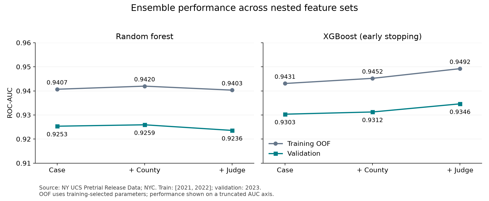

# E-02 random forest and XGBoost: development-year results

## Main result

The highest validation AUC among the six ensemble fits is **xgb / CASE_COURT_JUDGE: 0.934624**. The best published main baseline is lasso / CASE_COURT_JUDGE, AUC 0.923789; the point difference is +0.010835. This comparison does not select the final model; BD-06 must consider paired uncertainty, calibration, and fairness.

RF performs best with CASE_COURT (validation AUC 0.925922); adding judge changes its AUC by -0.002335. For XGBoost, adding county changes AUC by 0.000913, and adding judge changes it by 0.003380. County adds little in both ensembles; judge gains depend on the algorithm and representation.

All six OOF AUCs exceed their future-year validation AUCs. Apparent training AUC reaches 0.965199, showing why scoring fitted cases should be separated from OOF and validation performance. The primary interpretation uses validation, with the training/validation gap reported below.

## Training and validation AUC

| model | feature_set | train_apparent | train_oof | valid |
| --- | --- | --- | --- | --- |
| rf | CASE | 0.945050 | 0.940680 | 0.925338 |
| rf | CASE_COURT | 0.947385 | 0.941967 | 0.925922 |
| rf | CASE_COURT_JUDGE | 0.944624 | 0.940310 | 0.923587 |
| xgb | CASE | 0.947813 | 0.943071 | 0.930331 |
| xgb | CASE_COURT | 0.950588 | 0.945204 | 0.931244 |
| xgb | CASE_COURT_JUDGE | 0.965199 | 0.949226 | 0.934624 |

- `train_apparent`: fitted full-training model scored on the same training cases; optimistic and supplementary.
- `train_oof`: five-fold out-of-fold predictions on the training years, using training-selected hyperparameters. Preprocessing and model fitting occur within each fold. This is not nested cross-validation because tuning used all training folds.
- `valid`: the full-training fitted model scored on the independent validation year. Use this column for the primary comparison.

## Added county and judge information

| model | comparison | delta_roc_auc | delta_avg_precision | delta_brier |
| --- | --- | --- | --- | --- |
| rf | CASE_COURT minus CASE | 0.000584 | 0.004863 | -0.000424 |
| rf | CASE_COURT_JUDGE minus CASE_COURT | -0.002335 | -0.005422 | 0.000933 |
| xgb | CASE_COURT minus CASE | 0.000913 | 0.006885 | -0.000643 |
| xgb | CASE_COURT_JUDGE minus CASE_COURT | 0.003380 | 0.012880 | -0.001336 |

Positive AUC/AP increments and negative Brier increments favor the larger feature set. These are point estimates on identical validation cases. Judge information may behave differently across algorithms. A small or negative gain is evidence against assuming that extra identifiers always improve future-year prediction. Gains are predictive associations; assignment and unmeasured case mix remain possible explanations. The RF decline is specific to the current estimator and grid: its default max_features="sqrt" changes the number and proportion of split candidates as one-hot dimensions grow, so the decline does not establish that judge information has no signal. BD-06 should additionally report cases with individually coded training-year judges because `unseen` cases cannot use an individual judge coefficient or split.

## Comparison with published baselines

| model | CASE | CASE_COURT | CASE_COURT_JUDGE |
| --- | --- | --- | --- |
| lasso | 0.920337 | 0.920855 | 0.923789 |
| logit | 0.920289 | 0.920785 | 0.923637 |
| rf | 0.925338 | 0.925922 | 0.923587 |
| rule | 0.846492 | n/a | n/a |
| tree | 0.922505 | 0.922019 | 0.921855 |
| xgb | 0.930331 | 0.931244 | 0.934624 |

The charge rule uses only charge weight and the violent-felony flag; its CASE label does not mean it uses all CASE inputs. AUC is a ranking measure and is not classification accuracy. AP and Brier provide complementary information.

## All development metrics

| model | feature_set | split | roc_auc | avg_precision | brier | n | base_rate |
| --- | --- | --- | --- | --- | --- | --- | --- |
| rf | CASE | train_oof | 0.940680 | 0.729848 | 0.059875 | 193196 | 0.129294 |
| rf | CASE | valid | 0.925338 | 0.668503 | 0.066736 | 120457 | 0.128179 |
| rf | CASE_COURT | train_oof | 0.941967 | 0.735591 | 0.059297 | 193196 | 0.129294 |
| rf | CASE_COURT | valid | 0.925922 | 0.673366 | 0.066312 | 120457 | 0.128179 |
| rf | CASE_COURT_JUDGE | train_oof | 0.940310 | 0.733641 | 0.060363 | 193196 | 0.129294 |
| rf | CASE_COURT_JUDGE | valid | 0.923587 | 0.667944 | 0.067245 | 120457 | 0.128179 |
| xgb | CASE | train_oof | 0.943071 | 0.737889 | 0.058468 | 193196 | 0.129294 |
| xgb | CASE | valid | 0.930331 | 0.683544 | 0.065037 | 120457 | 0.128179 |
| xgb | CASE_COURT | train_oof | 0.945204 | 0.747432 | 0.057396 | 193196 | 0.129294 |
| xgb | CASE_COURT | valid | 0.931244 | 0.690430 | 0.064394 | 120457 | 0.128179 |
| xgb | CASE_COURT_JUDGE | train_oof | 0.949226 | 0.766555 | 0.055078 | 193196 | 0.129294 |
| xgb | CASE_COURT_JUDGE | valid | 0.934624 | 0.703310 | 0.063059 | 120457 | 0.128179 |

## Training-only early stopping

| feature_set | selected_trees | rounds_evaluated | best_internal_log_loss | internal_holdout_n | refit_n |
| --- | --- | --- | --- | --- | --- |
| CASE | 531 | 581 | 0.189537 | 38640 | 193196 |
| CASE_COURT | 580 | 630 | 0.187634 | 38640 | 193196 |
| CASE_COURT_JUDGE | 966 | 1016 | 0.181271 | 38640 | 193196 |

Each GridSearchCV fit, selected-model full-training fit and OOF fit repeats an internal 80/20 stratified split of only the rows supplied to that fit. Log-loss chooses the best boosting iteration with patience 50 and ceiling 2000; a fresh booster then refits every supplied row for that many rounds. The ceiling is preserved by sklearn clone, so OOF fits choose their own counts. The shared preprocessor is fitted on the outer training fold, including the internal early-stopping slice; it sees neither outer CV holdouts nor the validation year. Internal early-stopping log-loss is a tuning diagnostic, not an independent performance estimate.

The earlier fixed-400 run was exploratory and is superseded. Early stopping is applied identically across candidates without choosing the policy based on validation-year scores. The final-test workflow should freeze this policy with the chosen hyperparameters before refitting the expanded training years; it must never early-stop on the test year.

## Specifications and provenance

- Source checkout HEAD at execution: `74bf23c4582564d4c2aefa9bf7479858fae2e23f`. Only E-owned ensemble code and notebook are added; shared functions and feature definitions are unchanged.
- Training years: [2021, 2022], n=193,196; validation year: 2023, n=120,457. All development-year sample-flow steps matched the published counts when rebuilding from raw data. Test-year raw data, outcomes and predictions were not used.
- Three original nested sets: CASE (18 inputs), CASE_COURT (19), CASE_COURT_JUDGE (20). Race, ethnicity and gender are absent from the main models. No data-driven reduction from 18 to 14 CASE inputs was applied.
- Shared `fit_and_predict`, five-fold stratified shuffled CV, seed from `config.RANDOM_STATE` (408), scoring ROC-AUC. All six grid combinations per model are evaluated for each set on the full training sample. No reduction of the training dataset for tuning, class weighting or class oversampling. XGBoost retains its configured internal row subsampling (subsample=0.8).
- RF: 300 trees; max_depth in [8, 16, None]; min_samples_leaf in [20, 100]. XGBoost: ceiling 2000 trees, training-only log-loss early stopping with patience 50, histogram method, CPU with 8 threads; max_depth in [3, 5, 7], learning_rate in [0.05, 0.1], subsample=0.8. RF uses a fixed tree count; XGBoost selects its tree count within each training fit, then refits all supplied rows. No validation-year early stopping.
- Training-fitted one-hot encoding, unknown categories ignored, numeric gaps computationally zero-filled with `dcjs_missing` retained, no numeric scaling. Residual missing age follows the unchanged shared imputation specification. DCJS missingness is not interpreted as no prior record.
- Python 3.11.18; packages: {"numpy": "2.4.6", "pandas": "3.1.1", "pyarrow": "26.0.1", "scikit-learn": "1.9.1", "xgboost": "3.2.0"}. Summed shared-fit time for the six combinations: 39.1 minutes, excluding source rebuild, verification and reporting.

## Review artifacts and local files

- [Metrics](e02_metrics.csv), [fit diagnostics and selected parameters](e02_fit_diagnostics.csv), [all tuning candidates](e02_tuning.csv), [apparent training diagnostics](e02_train_apparent.csv), [nested validation gains](e02_nested_gains_valid.csv), [early-stopping diagnostics](e02_early_stopping.csv).
- Reproducible workflow: `notebooks/06_models_ensemble.ipynb`; definitions: `src/models_ensemble.py`.
- Local only: `data/processed/predictions_ensemble.parquet`, six `models/y_detain_*_rf.joblib` / `*_xgb.joblib` files and provenance-checked checkpoints. Case-level predictions and fitted models must not be committed.

Verification: the shared workflow, metric and feature tests passed (34 tests); both ensemble estimators passed a synthetic shared-pipeline smoke check with test-label sentinels; early-stopping checks confirmed actual stopping on noisy data, cloning/serialization and full-row refits, rejected external eval_set, and unchanged predictions/tree counts after validation-label reversal. Every saved model reproduced its validation probabilities to 1e-12; training-only encoder categories, prediction keys, coverage and labels were checked. The three raw development files matched the SHA-256 prefixes published in data/README.md.

Prior/pending-record reference dates remain undocumented (data/README.md D14). The outcome is a historical bail/remand decision; it does not measure actual detention or future offending. These results do not establish causal effects or discriminatory treatment.
